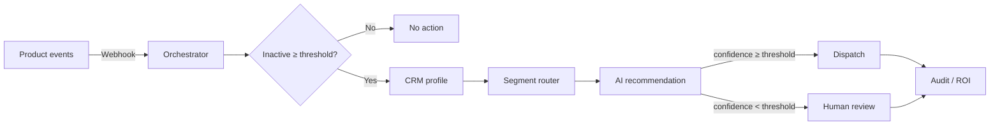

# Avles

**AI-powered Marketing Operations & Lifecycle Automation.**

Avles is an illustrative SaaS dashboard for re-engagement automation: deterministic rules decide eligibility and segments, an AI layer proposes the message angle, low-confidence decisions go to human review, and every step is measurable.

> **Illustrative demo — sample data.** All users, events and metrics are synthetic and generated in the browser. Nothing is connected to a production system, no messages are sent, and no live AI inference runs in the public build. Avles is a fictional product and is not affiliated with any company.

---

## 🎬 Product Demo Walkthrough

[](https://github.com/Selva201998/Avles_Martech/blob/main/martech%20demo.mp4)

> 📹 **[Click here to watch the full product demo video (martech demo.mp4)](https://github.com/Selva201998/Avles_Martech/blob/main/martech%20demo.mp4)**

---

## Quick start

```bash
npm install
npm run dev          # http://localhost:5173  →  opens the Re-engagement Control Center (#/overview)
```

| Command | Purpose |
| --- | --- |
| `npm run dev` | Vite dev server |
| `npm run build` | Type-check (`tsc -b`) and production build to `dist/` |
| `npm run preview` | Serve the production build locally |
| `npm run lint` | oxlint |
| `npm run typecheck` | TypeScript project check only |
| `npm run server` | Optional mock API on port 3001 (CRM lookup, simulated dispatch, audit log, server-side LLM proxy) |

Recommended URL for screenshots: `http://localhost:5173/#/overview` at 1440 × 900 or wider.

## Routes

Hash routes work on any static host without rewrites.

| Route | View |
| --- | --- |
| `#/overview` | KPIs, lifecycle funnel, executions trend, segment conversion, operational hours |
| `#/automation` (`/error-queue`, `/idempotency`, `/architecture`, `/node-3` …) | Workflow canvas, run simulator, error queue, idempotency log |
| `#/users/<id>` | Sample user profiles and lifecycle timeline |
| `#/segments/<id>` | Deterministic segment rules |
| `#/campaigns/<id>` | Plays per segment and channel |
| `#/ai-recommendations` | AI decision audit trail, approve / reject |
| `#/analytics` | ROI model and calculator |
| `#/integrations` | Connectors and what production would require |
| `#/settings` | Inactivity and human-review thresholds, governance standards |

## What is real vs. simulated

| Real (runs in the browser) | Simulated / sample |
| --- | --- |
| Workflow decision logic: idempotency, validation, inactivity rule, segmentation, confidence gate, 429 retry → error queue | All metrics, users, events, campaign performance |
| Human-review approve / reject, error-queue reprocessing, notifications feed | CRM, messaging platform, warehouse |
| Configurable thresholds (Settings) applied to new simulator runs | AI recommendations (deterministic sample recommender) |
| Global search, date-range filtering, guided tour | — |
| Importable n8n workflow (`public/n8n_avles_reengagement_workflow.json`) | — |

State lives in memory for the session; a reload resets the demo.

## Architecture

- **Stack:** React 19, TypeScript, Vite 8, Tailwind CSS v4 (`@theme` tokens in `src/index.css`), Recharts, lucide-react. No router or state library — a 40-line hash router and a `useSyncExternalStore` store are sufficient for nine flat views.
- **Layout:** `src/components/layout` (sidebar, top bar with search, date range, notifications, account menu, footer).
- **Pages:** `src/pages/*Page.tsx`, one per route.
- **Reusable UI:** `src/components/ui` (Card, Badge, Button, SegmentedControl, Modal, Table, InfoTip, ActionMenu, Toast).
- **Dashboard widgets:** `src/components/dashboard` (KpiCard, Sparkline, LifecycleFunnel, ExecutionsChart, SegmentConversionChart, OperationalHoursChart, PrincipleCard).
- **Data (separate from UI):** `src/data` — `dashboardData.ts` (KPIs, funnel, seeded daily series), `catalog.ts` (segments, campaigns, integrations), `mockData.ts` (users, workflow nodes, decisions, governance), `roiModel.ts`, `searchIndex.ts`.
- **Services:** `src/services/automationEngine.ts` (in-browser workflow simulator + store), `src/services/aiService.ts` (sample recommender; optional proxy adapter).
- **Branding:** `src/config/brand.ts` — change product/workspace names in one place.



### Design system

Primary indigo/violet (`brand-*`), with blue, teal and a restrained orange as accents; neutral `canvas`, `surface`, `line`, `ink-*` tokens. Chart series colours (`#6e56f0`, `#0d9488`, `#e8833a`) were checked for colour-vision-deficiency separation; the orange is always paired with direct value labels.

## Optional: live LLM during local development

The public build never calls a model. To experiment locally with a real model **without exposing a key to the browser**:

1. Copy `.env.example` to `.env` and set `GEMINI_API_KEY` (server-side variable — no `VITE_` prefix).
2. Set `VITE_LLM_PROXY_URL=/api/ai/recommend`.
3. Run `npm run server` and `npm run dev` in two terminals. Vite proxies `/api` to the mock server, which holds the key.

Do not deploy a build with `VITE_LLM_PROXY_URL` set unless a real, authenticated backend sits behind it.

### n8n workflow

`public/n8n_avles_reengagement_workflow.json` mirrors the eight-step pipeline. After importing into n8n:

- Attach a **Header Auth** credential (`x-goog-api-key`) to step 6 — the file contains no API key.
- Set a test inbox on the optional preview-email node (placeholder `your-test-inbox@example.com`).
- Steps 4, 8 and 9 call the mock API (`npm run server`).

## Production gaps (backend work required)

- Authentication, multi-tenant workspaces and role-based access.
- Persistent storage for runs, decisions, settings and campaign state.
- Real connectors (CRM/CDP, messaging provider, warehouse) with secrets in a server-side vault.
- Server-side LLM service with prompt versioning, evaluation and cost controls.
- Event ingestion with durable idempotency keys (e.g. Redis/DB with TTL) and a real retry queue.
